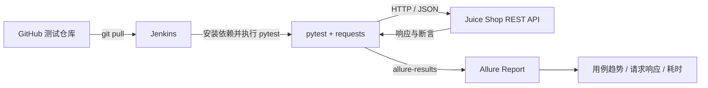

# OWASP Juice Shop API 自动化测试与 Jenkins CI

基于 Python、pytest、requests、Allure 和 Jenkins 构建的接口自动化回归项目。被测系统为本地 Docker 部署的 OWASP Juice Shop `20.3.0`，测试代码与被测业务代码独立维护。

## 项目架构



## 技术栈

- Python 3.11
- pytest、requests、allure-pytest
- OWASP Juice Shop 20.3.0
- Jenkins 2.504.1 LTS、JDK 17
- Git、GitHub、Allure Report

## 测试覆盖

| 模块 | 场景 | 主要断言 |
|---|---|---|
| 用户认证 | 正确账号登录 | HTTP 200、Token 非空、购物篮字段 |
| 用户认证 | JWT 内容校验 | 邮箱、角色、购物篮 ID |
| 用户认证 | 错误密码 | HTTP 401、不返回 Token |
| 商品目录 | 商品列表 | 响应结构、必填字段、价格类型 |
| 商品目录 | 商品详情 | HTTP 200、商品 ID 与名称 |
| 商品目录 | 关键字搜索 | 返回结果与关键字匹配 |
| 商品目录 | 无结果搜索 | HTTP 200、结果为空 |
| 购物篮 | 合法 Token 访问 | HTTP 200、购物篮归属、商品列表 |
| 购物篮 | 匿名访问 | HTTP 401 |
| 购物篮 | 非法 Token 访问 | HTTP 401 |

共 10 条接口用例，覆盖正向、反向、鉴权、契约和数据一致性场景。

## 工程结构

```text
juice-shop-auto-test/
├── framework/
│   └── api_client.py        # HTTP Client、JWT 解析、敏感字段脱敏
├── testcases/
│   ├── conftest.py          # 环境配置、Session、认证 Fixture
│   ├── test_user.py         # 登录与 JWT 鉴权测试
│   ├── test_products.py     # 商品目录与搜索测试
│   └── test_basket.py       # 购物篮鉴权测试
├── Jenkinsfile              # Windows Jenkins 声明式流水线
├── pytest.ini               # pytest 收集规则与标记
├── requirements.txt
└── README.md
```

## 本地运行

确保 Juice Shop 已在 `http://127.0.0.1:3000` 启动：

```powershell
python -m pip install -r requirements.txt
python -m pytest testcases --alluredir=allure-results --clean-alluredir
```

运行冒烟测试：

```powershell
python -m pytest testcases -m smoke
```

指定测试环境或账号：

```powershell
$env:JUICE_SHOP_URL = "http://127.0.0.1:3000"
$env:JUICE_SHOP_EMAIL = "admin@juice-sh.op"
$env:JUICE_SHOP_PASSWORD = "admin123"
python -m pytest testcases
```

真实项目中应通过 Jenkins Credentials 注入账号密码，不要提交到仓库。

## Allure 报告

`ApiClient` 会自动把请求参数、脱敏后的响应和耗时附加到 Allure：

- 按 Epic、Feature、Story、Severity 分类；
- 查看每条用例的请求方法、路径、状态码和处理结果；
- 查看正向与异常场景；
- 查看用例数量、失败详情和整体耗时。

密码、Token 等敏感字段在写入报告前会替换为 `***`。

## Jenkins 流水线

Jenkins 负责：

1. 从 GitHub 拉取最新测试代码；
2. 安装 `requirements.txt` 中锁定的依赖；
3. 执行 pytest 并生成 `allure-results`；
4. 发布 JUnit XML 与 Allure 可视化报告。

当前 Jenkins 使用 Windows Freestyle 任务，Python 可执行文件为：

```text
C:\Users\dirou\AppData\Local\Programs\Python\Python311\python.exe
```

建议把 Jenkins 批处理命令中的依赖安装改为：

```bat
C:\Users\dirou\AppData\Local\Programs\Python\Python311\python.exe -m pip install -r requirements.txt
C:\Users\dirou\AppData\Local\Programs\Python\Python311\python.exe -m pytest testcases --alluredir=allure-results --clean-alluredir
```

## 简历描述参考

> 基于 Python 3.11、pytest 与 requests 构建 OWASP Juice Shop 接口自动化测试框架，采用 API Client 与 Fixture 分层设计，覆盖登录认证、JWT 鉴权、商品目录和购物篮等核心链路，设计 10 条正向、反向及契约测试用例。

> 集成 GitHub、Jenkins 与 Allure，实现代码拉取、依赖安装、接口回归和可视化报告发布的完整 CI 流程；通过自动附加脱敏请求/响应与测试环境信息，提升失败定位效率。
